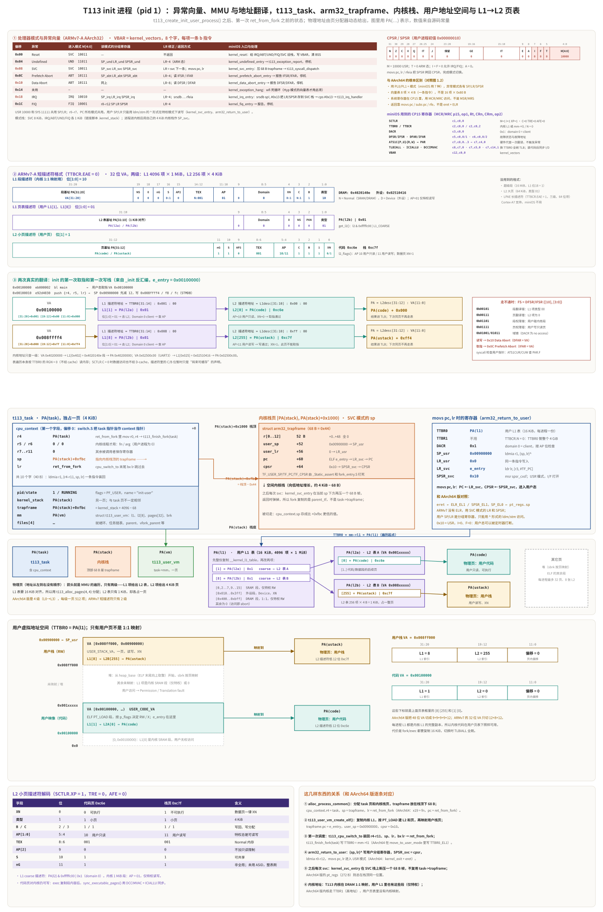
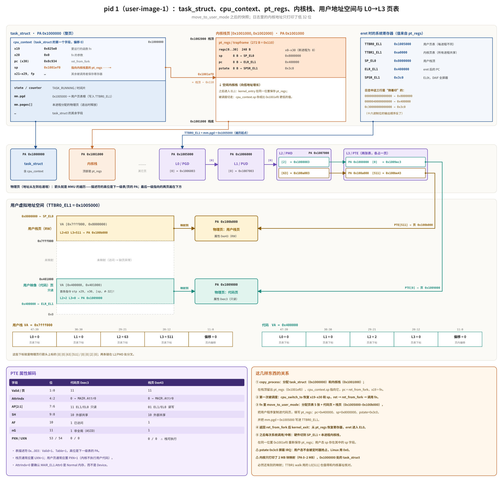

# miniOS 用户进程创建与切换调用链

本文对应当前 miniOS 的实现，说明通过内核启动函数创建用户进程、首次调度进入 EL0，以及后续异常往返的调用关系。前半部分是树莓派 AArch64 内核；最后一部分讲 T113（ARMv7-A）内核里 fork、vfork、clone 的统一实现，以及它和 xv6、Linux 的区别。

## 总调用链

```text
kernel_main()
└── copy_process(PF_KTHREAD, kernel_process, 0, 0)
    ├── allocate_kernel_page()                  分配 task_struct
    │   └── task_struct.cpu_context             位于 task_struct 偏移 0
    ├── allocate_kernel_page()                  分配独立内核栈
    ├── task_pt_regs(p)
    │   └── pt_regs                             固定放在内核栈高地址端
    ├── p->cpu_context.x19 = kernel_process     首次执行的内核函数
    ├── p->cpu_context.x20 = 0                  函数参数
    ├── p->cpu_context.pc = ret_from_fork       cpu_switch_to 的返回目标
    └── p->cpu_context.sp = childregs           首次运行时的内核 SP

kernel_main()
└── schedule()
    └── _schedule()
        └── switch_to(next)
            ├── switch_user_pgd(next->mm->pgd)  已有用户进程才切换 TTBR0_EL1
            └── cpu_switch_to(prev, next)
                ├── 保存 prev 的 x19～x30 和 SP
                ├── 恢复 next 的 x19～x30 和 SP
                └── ret
                    └── ret_from_fork
                        ├── preempt_enable()
                        ├── x19 != 0
                        └── blr x19
                            └── kernel_process()
                                └── launch_user_image(...)
                                    ├── allocate_kernel_page()          分配 mm_struct
                                    ├── allocate_pagetable_page()       分配用户 PGD
                                    └── move_to_user_mode(...)
                                        ├── map_and_copy_user_code()    映射并复制用户代码
                                        ├── allocate_user_page()        映射用户栈
                                        ├── task_pt_regs(current)
                                        ├── regs->pc = 用户入口地址
                                        ├── regs->sp = 用户栈顶
                                        ├── regs->pstate = EL0t 状态
                                        └── TTBR0_EL1 = current->mm->pgd

ret_from_fork
└── kernel_process() 返回
    └── ret_to_user                         位于 blr x19 后面
        ├── 从 pt_regs 读取 sp
        │   └── SP_EL0 = pt_regs->sp
        ├── 从 pt_regs 读取 pc
        │   └── ELR_EL1 = pt_regs->pc
        ├── 从 pt_regs 读取 pstate
        │   └── SPSR_EL1 = pt_regs->pstate
        └── kernel_exit 0
            ├── 恢复 x0～x30
            ├── 释放 pt_regs 栈帧
            └── eret
                └── EL0 用户入口
```

## 第一个用户进程

```text
kernel_main
└── copy_process(PF_KTHREAD, kernel_process, ...)
    └── 首次调度
        └── ret_from_fork
            └── kernel_process
                └── launch_user_image("user-image-1", ...)
                    └── move_to_user_mode
                        ├── 用户代码 VA 0x400000
                        ├── 用户栈 VA 0x07fff000～0x08000000
                        ├── ELR_EL1 = 0x400000
                        ├── SP_EL0 = 0x08000000
                        └── TTBR0_EL1 = 该进程的用户 PGD
```

## 第二个用户进程

```text
kernel_main
└── copy_process(PF_KTHREAD, kernel_process2, ...)
    └── 首次调度
        └── ret_from_fork
            └── kernel_process2
                └── launch_user_image("user-image-2", ...)
                    └── move_to_user_mode
                        ├── 用户代码 VA 0x401000
                        ├── 用户栈 VA 0x07fff000～0x08000000
                        ├── ELR_EL1 = 0x401000
                        ├── SP_EL0 = 0x08000000
                        └── TTBR0_EL1 = 该进程的用户 PGD
```

两个进程可以使用相同的用户栈虚拟地址，因为各自的 `TTBR0_EL1` 指向不同的用户页表，最终映射到不同物理页。

## 系统调用调用链

```text
EL0 用户代码
└── call_sys_xxx()
    └── svc #0
        └── EL0 synchronous exception
            └── el0_sync
                ├── kernel_entry 0
                │   ├── CPU 已切换到该任务的 SP_EL1
                │   └── 在内核栈顶部保存新的 pt_regs
                └── el0_svc
                    ├── 根据 x8 查找 sys_call_table
                    ├── blr sys_xxx
                    └── ret_from_syscall
                        ├── 把返回值写入 pt_regs->x0
                        └── kernel_exit 0
                            ├── 恢复用户寄存器
                            └── eret 返回 EL0
```

## 定时器中断和进程切换

```text
EL0 用户代码
└── 定时器 IRQ
    └── el0_irq
        ├── kernel_entry 0                       保存当前用户 pt_regs
        └── handle_irq()
            └── timer_tick()
                └── _schedule()
                    └── switch_to(next)
                        ├── switch_user_pgd(next->mm->pgd)
                        │   └── TTBR0_EL1 = next 用户 PGD
                        └── cpu_switch_to(prev, next)
                            ├── 保存 prev.cpu_context
                            ├── 恢复 next.cpu_context
                            └── 返回到 next 原先暂停的位置

next 的异常返回路径
└── handle_irq() 返回
    └── kernel_exit 0
        ├── 从 next 内核栈上的 pt_regs 恢复现场
        └── eret 返回 next 的 EL0
```

## 两类上下文的职责

```text
task_struct
└── cpu_context
    ├── x19～x30
    ├── 内核 SP
    └── 用途：EL1 调度切换

内核栈顶部
└── pt_regs / TrapFrame
    ├── x0～x30
    ├── SP_EL0
    ├── ELR_EL1
    ├── SPSR_EL1
    └── 用途：EL0 异常进入和 eret 返回
```

`cpu_context` 是 `task_struct` 的第一个成员，因此两者起始地址相同。这是当前内核与 `cpu_switch_to` 汇编之间的软件布局约定，并非 ARM64 硬件规定。

## TTBR0 与 TTBR1

```text
低地址用户空间
└── TTBR0_EL1
    └── current->mm->pgd
        ├── 用户代码
        └── 用户栈

高半区内核空间
└── TTBR1_EL1
    └── 全局 kernel_pgd
        ├── 内核代码和数据
        ├── task_struct 与内核栈的直接映射
        └── MMIO
```

调度用户进程时只需切换 `TTBR0_EL1`；`TTBR1_EL1` 保持指向公共内核页表。

## PSTATE 注意事项

当前代码使用：

```c
regs->pstate = PSR_MODE_EL0t | PSR_DAIF_MASK;
```

这会得到 `0x3c0`，屏蔽 Debug、SError、IRQ 和 FIQ。若希望 EL0 用户进程能够被定时器正常抢占，应改为：

```c
regs->pstate = PSR_MODE_EL0t;
```

即初始 `SPSR_EL1` 为 `0x0`。

## T113（ARMv7-A）：fork、vfork 与 clone

前面各节讲的是树莓派 AArch64 内核。从这一节起讲 T113 内核（Cortex-A7，
ARM32）。它的进程创建写在 `src/kernel/sched/core.c` 里：

- 用户态能用的系统调用只有 `fork` 和 `vfork`；
- 内核线程也走同一条路径；
- 三者共用一个入口 `t113_kernel_clone()`，形状对齐 Linux 的 `kernel_clone()`。

### 三种创建方式的语义

| | fork | vfork | clone（Linux） | T113 内核线程 |
| --- | --- | --- | --- | --- |
| 地址空间 | 复制一份：Linux 写时复制，T113/xv6 立即整页拷贝 | 和父进程共用同一个 mm | `CLONE_VM` 决定共享还是复制 | 不需要用户地址空间，只用内核页表 |
| 父进程 | 立即返回，继续运行 | 挂起，直到子进程 exec 或 exit | 带 `CLONE_VFORK` 时同 vfork | 不受影响 |
| 子进程返回值 | 0 | 0 | 0（线程用调用者给的新栈） | 不回用户态，直接跑 `fn(arg)` |
| 文件描述符 | 每个 fd 加一次引用 | 同 fork | 带 `CLONE_FILES` 时共享整张表 | 无 |
| 典型用途 | 通用的“复制自己” | 紧接 exec 的 shell 场景，省掉一次拷贝 | 线程、容器、命名空间 | 内核后台工作 |
| T113 入口 | `T113_SYS_FORK` → `t113_fork_user()` | `T113_SYS_VFORK` → `t113_vfork_user()` | 无用户态 clone 系统调用 | `t113_create_kernel_thread()` |

fork 和 vfork 的差别只在两件事上：

- 子进程有没有自己的地址空间；
- 父进程要不要等。

用时间线看：

```text
fork:
 父 ──fork()──┬──────────── 继续运行（拿到子 pid）────────────────→
              │  复制 mm（T113: 每个用户页都 memcpy 一遍）
 子           └── 从 fork() 返回 0 ── exec / 运行 ── exit ──→ ZOMBIE
                                                         父 wait() 回收

vfork:
 父 ──vfork()─┐ WAITING（不被调度）                ┌── 返回子 pid ──→
              │  共享 mm（引用计数 +1，不拷贝）    │
 子           └── 从 vfork() 返回 0 ── exec ────────┘  t113_vfork_complete()
                  （这段时间子进程在父进程的地址空间、
                    父进程的用户栈上运行）
```

### 统一实现：`t113_kernel_clone()`

T113 内核用三个“创建策略”标志描述子进程怎样继承父进程的资源。它们定义在
`src/include/t113/sched.h`，刻意和描述“已有任务是什么”的 `PF_*` 分开：

| 标志 | 值 | 含义 | Linux 对应 |
| --- | --- | --- | --- |
| `T113_CLONE_VM` | 0x1 | 共享父进程 `mm`，不复制 | `CLONE_VM` |
| `T113_CLONE_VFORK` | 0x2 | 父进程等子进程 exec/exit，必须和 VM 一起用 | `CLONE_VFORK` |
| `T113_CLONE_KTHREAD` | 0x4 | 创建内核线程，忽略父 trapframe | `kernel_thread()` 的 `PF_KTHREAD` 路径 |

三个外部入口只是不同的标志组合：

```text
t113_fork_user(tf)              = t113_kernel_clone(0,                   tf, "fork-child",  0, 0)
t113_vfork_user(tf)             = t113_kernel_clone(VM | VFORK,          tf, "vfork-child", 0, 0)
                                  + t113_sched_yield()       父进程在这里让出 CPU
t113_create_kernel_thread(n,f,a)= t113_kernel_clone(KTHREAD,             0,  n,             f, a)
```

`t113_kernel_clone()` 的完整流程：

```text
t113_kernel_clone(clone_flags, parent_tf, name, kernel_fn, kernel_arg)
├── 校验标志
│   ├── 只允许 VM | VFORK | KTHREAD                     其他位 → -1
│   ├── VFORK 必须带 VM                                   vfork 的定义就是共享地址空间
│   └── 非 KTHREAD 时要求 parent_tf 非空且当前任务是 PF_USER
├── alloc_process_common()                              所有任务共用的部分
│   ├── t113_alloc_page()  → struct t113_task（独占 1 页）
│   ├── t113_alloc_page()  → 4 KiB 内核栈
│   ├── pid = next_pid++                                 sched_lock 保护
│   ├── state = RUNNING
│   ├── trapframe = 栈顶 - sizeof(arm32_trapframe)       68 字节，清零
│   └── cpu_context: r4 = task, sp = trapframe, lr = ret_from_fork
├── KTHREAD
│   ├── flags = PF_KTHREAD
│   └── cpu_context.r5 = kernel_fn, r6 = kernel_arg      ret_from_fork 里 blx r5
├── 用户进程
│   ├── flags = PF_USER, parent = t113_current
│   ├── mm = VM ? t113_current->mm                       共享
│   │          : t113_user_vm_clone(t113_current->mm)   新 L1 表 + 逐页拷贝
│   ├── VM    → t113_user_vm_get(mm)                    references++
│   ├── VFORK → child->vfork_parent = t113_current
│   ├── *child->trapframe = *parent_tf                   17 个字逐个拷贝
│   ├── child->trapframe->r[0] = 0                       子进程看到的返回值
│   └── files[i] = 父 files[i]; t113_vfs_file_get()      共享打开文件，引用 +1
└── sched_lock 内
    ├── VFORK → t113_current->state = WAITING            父进程从此不会被选中
    ├── task_list_append(child)                          全体任务链表（wait/exit 用）
    └── ready_append(child)                              就绪环
返回 child->pid（父进程这一侧的返回值）
```

KTHREAD 分支和用户分支唯一的公共部分是 `alloc_process_common()`：它给每个
新任务装上同样的“第一次运行”路径 `ret_from_fork`。真正的差别都推迟到子进程
第一次被调度时才体现。

### 任务结构与内核栈布局

```text
task 页（4 KiB）                          内核栈页（4 KiB）
┌──────────────────────────┐ +0          ┌───────────────────────────┐ stack+0
│ cpu_context              │             │                           │
│   r4..r11, sp, lr        │ switch.S    │      ↓ SVC 模式栈向下长    │
│ pid  state  flags  name  │ 要求在偏移0 │                           │
│ kernel_stack ────────────┼────────────→│                           │
│ trapframe ───────────────┼──┐          │  每次 SVC 再压一个 68 B 帧 │
│ mm ──→ struct t113_user_vm│  │          ├───────────────────────────┤ stack+4096-68
│ ready_prev/next          │  └─────────→│ struct arm32_trapframe    │
│ task_prev/next  parent   │             │   r[0..12]  (+0..+48)     │
│ vfork_parent  wake_tick  │             │   user_sp   (+52)         │
│ exit_status  files[4]    │             │   user_lr   (+56)         │
└──────────────────────────┘             │   pc (+60)  cpsr (+64)    │
                                         └───────────────────────────┘ stack+4096
cpu_context.sp 初值 = trapframe，cpu_context.lr 初值 = ret_from_fork
```

`task->trapframe` 只在子进程第一次返回用户态时用。之后每次 `svc`，
`kernel_svc_entry` 都在当前 SVC 栈顶下方再压一个新的 trapframe，系统调用
返回时弹掉。所以 fork 拷贝的必须是这次系统调用的帧，也就是
`t113_syscall_dispatch(tf)` 传下来的 `parent_tf`，而不是
`t113_current->trapframe`。`_Static_assert` 把偏移 52/60/64 和
`fork_entry.S` 里的 `TF_USER_SP/TF_PC/TF_CPSR` 钉在一起。

下面两张图把“第一次进入用户态之前”的全部状态画在一起：任务结构、内核栈顶的
寄存器帧、返回用户态时的系统寄存器、页表遍历、用户地址空间和描述符位。
第一张是 T113 的 init 进程。它的上半部分完全按 AArch32（ARMv7-A，Cortex-A7）
来画：处理器模式与异常向量、CP15 寄存器、短描述符格式，以及 init 头两条指令
实际触发的两次地址翻译（见下文“AArch32 的异常、MMU 与地址翻译”）。
第二张是树莓派 AArch64 版的 pid 1，只作对照，两张图的下半部分面板一一对应。T113 图里的物理地址由页分配器动态给出，所以写成
`PA(task)`、`PA(l1)` 这样的符号，其余数值都来自源码常量。





两张图对照下来，差别集中在这几处：

| 方面 | 树莓派 AArch64 | T113 ARMv7-A |
| --- | --- | --- |
| 切换上下文 | x19–x29、fp、sp、pc（x19 = fn） | r4–r11、sp、lr（r4 = task，r5/r6 = 内核线程的 fn/arg） |
| 用户寄存器帧 | `pt_regs` 272 B，总在栈顶同一位置 | `arm32_trapframe` 68 B，每次 svc 在当前 sp 下新压一个 |
| 回到用户态 | `kernel_exit` + `eret`，ELR_EL1 / SPSR_EL1 / SP_EL0 | `ldmia {sp, lr}^` + `msr spsr` + `movs pc, lr` |
| 页表 | 4 级（L0→L3），每级 512 项，48 位 VA | 2 级短描述符：L1 4096 项 × 1 MiB（16 KiB），L2 256 项 × 4 KiB |
| 内核映射 | TTBR1_EL1，高地址，用户页表里没有 | TTBCR.N = 0，每个用户 L1 都是内核 L1 的完整副本（段只允许特权访问） |
| 用户布局 | 代码 0x400000，栈顶 0x8000000 | 代码 0x00100000，栈顶 0x00900000 |
| 进入用户态时的状态寄存器 | SPSR = 0x3c0（EL0t，DAIF 全屏蔽） | CPSR = 0x10（USR，IRQ/FIQ 打开） |

#### AArch32 的异常、MMU 与地址翻译

**处理器模式和分组寄存器。** ARMv7-A 不用 AArch64 的 EL，而是用特权级 PL0/PL1
（虚拟化扩展另有 PL2）加处理器模式。miniOS 用到其中 7 种：USR、SYS、SVC、IRQ、
FIQ、ABT、UND；Cortex-A7 另有 MON（安全扩展）和 HYP（虚拟化扩展），miniOS 不用。
模式号在 CPSR[4:0]。除 USR/SYS 共用一组外，每种
异常模式都有自己的 SP、LR、SPSR（FIQ 还有自己的 r8–r12）。所以
`kernel_reset` 要依次 `cps` 进每种模式设栈（SVC 8 KiB，其余各 1 KiB）；用户
态的 SP/LR 在特权模式下看不见，`kernel_svc_entry` 和 `arm32_return_to_user`
只能用 `stmia/ldmia {sp, lr}^` 这种带 `^` 的形式访问。

**异常向量。** `VBAR`（CP15 c12）指向 `kernel_vectors`，表里是 8 条
`b handler` 指令，每项 4 字节，按偏移 0x00 Reset、0x04 Undefined、0x08 SVC、
0x0C Prefetch Abort、0x10 Data Abort、0x14 未用、0x18 IRQ、0x1C FIQ 排列。
进入异常时硬件把返回地址放进该模式的 LR，旧 CPSR 放进 SPSR；LR 的偏移因异常
而异（Undef/Prefetch/IRQ/FIQ 减 4，Data Abort 减 8，SVC 不用改）。返回也不是
一条统一指令：SVC 用 `movs pc, lr`，IRQ 先用 `srsdb sp!, #0x13` 把 LR_irq 和
SPSR_irq 压到 SVC 栈，处理完再用 `rfeia sp!` 一次恢复 PC 和 CPSR。
Undef、Abort、FIQ 在 miniOS 里只报告现场然后停机。

**CP15 与 MMU 配置。** 系统寄存器都在协处理器 CP15 里，用 `mcr/mrc p15, …`
访问。`t113_mmu_init()` 写 TTBR0 = `__kernel_l1_table`、TTBCR = 0（N = 0，
TTBR0 覆盖整个 4 GiB，TTBR1 不参与）、DACR = 1（domain 0 为 client，按 AP
位检查），再在 SCTLR 里打开 M、I、XP，清 TRE、AFE，并且暂不打开 C（D-cache）。
内核 L1 全是 1 MiB 段，1:1 映射：0x000–0x00F MiB 是 SRAM（Normal），
0x010–0x3FF MiB 是外设（Device、XN），0x400–0xBFF MiB 是 DRAM（Normal），
都只允许特权访问（AP = 01）。

**短描述符和两级翻译。** 32 位 VA 拆成 [31:20] L1 索引、[19:12] L2 索引、
[11:0] 页内偏移。

```text
L1 描述符地址 = TTBR0[31:14] : VA[31:20] : 00
   位[1:0] = 10 → 段：PA = desc[31:20] : VA[19:0]            （内核，查一级就结束）
   位[1:0] = 01 → 页表：继续
L2 描述符地址 = L1desc[31:10] : VA[19:12] : 00
   位[1]   = 1  → 小页：PA = desc[31:12] : VA[11:0]
```

每个用户 L1 都是内核 L1 的完整副本，只把 L1[1]（代码）和 L1[8]（栈）换成
页表描述符。这一点与 Linux 在 ARM 短描述符下的做法相同：TTBCR.N = 0，每个
进程的 pgd 都带一份内核映射。区别是 Linux 在同一页里还放了软件用的影子 PTE，
miniOS 的 1 KiB L2 表则单独占一页。

**两次真实的翻译。** 从 `_init` 的反汇编看，`e_entry` = 0x00100000，第一条指令
`bl main` 触发对 VA 0x00100000 的用户态取指：L1[1] → L2A[0] = PA(code) | 0xc6e，
AP = 10（用户只读）、XN = 0，通过。`main` 的第一条指令 `push {r4, r5, lr}`
在 SP = 0x00900000 时写 0x008ffff4–0x008fffff：L1[8] → L2B[255] =
PA(ustack) | 0xc7f，AP = 11（用户读写），通过；同一页 XN = 1，不能取指。

**走不通时。** 翻译或权限检查失败，数据访问进 Data Abort（DFSR 给状态，DFAR
给地址），取指进 Prefetch Abort（IFSR/IFAR）。FS 编码 0b00101/0b00111 是段/页
翻译错，0b01101/0b01111 是段/页权限错。系统调用检查用户指针时，不让它真的
出错，而是用 ATS1CUR/ATS1CUW（CP15 c7, c8）让硬件代查一次翻译，再看 PAR 的
F 位（`t113_mmu_probe()`）。切换进程只换 TTBR0 并 TLBIALL 全刷，没有使用
ASID（CONTEXTIDR）。

### 子进程第一次运行：`ret_from_fork`

```text
t113_sched_tick() / t113_sched_yield()
└── schedule_next()
    ├── 在就绪环里从 prev->ready_next 开始找 state == RUNNING
    │   └── 一个都没有 → boot_context（kernel_boot 的 wfi 循环）
    ├── t113_current = next
    ├── switch_task_mm(next)            TTBR0 ← next->mm->l1 或内核 L1 表
    └── t113_cpu_switch_to(prev, next)  switch.S
        ├── stmia r0, {r4-r11, sp, lr}  保存 prev
        ├── ldmia r1, {r4-r11, sp, lr}  装入 next：r4=task, sp=trapframe, lr=ret_from_fork
        └── bx lr
            └── ret_from_fork           fork_entry.S
                ├── t113_finish_fork(r4)
                │   ├── PF_KTHREAD → t113_switch_kernel_vm()
                │   └── PF_USER    → t113_switch_user_vm(task->mm)
                ├── 内核线程：cpsie i; mov r0, r6; blx r5
                │   └── fn(arg) 返回 → t113_task_exit()   state = IDLE, wfi
                └── 用户进程：t113_task_trapframe(r4) → arm32_return_to_user(tf)
                    ├── ldmia {sp, lr}^        写 User 模式的 banked SP/LR
                    ├── lr  = tf->pc
                    ├── spsr = tf->cpsr        0x10 = User 模式，IRQ 打开
                    ├── ldmia r0-r12           r0 = 0
                    └── movs pc, lr            CPSR ← SPSR，跳到 svc 的下一条
                        └── 子进程在用户态从 fork()/vfork() 返回 0
```

`r4/r5/r6` 是 miniOS 自己定的约定：它们是被调用者保存寄存器，
`t113_cpu_switch_to` 会原样恢复，所以可以用来把“任务指针、内核函数、参数”
带到 `ret_from_fork`。AArch64 版本用的是 `x19/x20`，道理相同。

### vfork：父进程怎样等、怎样被唤醒

```text
 父进程 P                          调度器                      子进程 C
 vfork() ─ svc #0, r7 = 14 ─→ t113_syscall_dispatch(tf)
   t113_vfork_user(tf)
     t113_kernel_clone(VM|VFORK)
       C.mm = P.mm（references = 2）
       C.vfork_parent = P
       P.state = WAITING
     t113_sched_yield() ──────→ schedule_next()
                                P 不是 RUNNING，跳过
                                选中 C ──────────────────────→ ret_from_fork
                                                               用户态 vfork() 返回 0
                                                               exec("/bin/ls", argv)
                                                               └── sys_exec()
                                                                   ├── 新建 vm，装入 ELF
                                                                   ├── C.mm = 新 vm
                                                                   ├── t113_vfork_complete(C)
                                                                   │   ├── P.state = RUNNING
                                                                   │   └── C.vfork_parent = 0
                                                                   ├── 切 TTBR0 到新 vm
                                                                   └── t113_user_vm_put(P 的 mm)
                                                                       references = 1
                                ...之后某次调度选中 P
 ←──────────────────────────── t113_sched_yield() 返回
 t113_vfork_user() 返回 C 的 pid
 用户态 vfork() 返回 C 的 pid
```

`t113_vfork_complete()` 有两个调用点，对应 Linux 在 `mm_release()` 里
`complete(vfork_done)` 的两种情况：

- `sys_exec()`（`src/kernel/syscall.c`）：子进程换上了自己的地址空间；
- `t113_exit_current()`（`sched/core.c`）：子进程没 exec 就退出了。

父进程用的是 `WAITING` 状态，不是忙等。`t113_exit_current()` 里，“父进程在
WAITING 就改回 RUNNING”这条规则同时服务了 `wait()` 和 vfork。

> 注意：vfork 的子进程在父进程的用户栈上运行。
> `user-t113/usys.S` 的 `__sys_vfork` 用 `push {r7, lr}` / `pop {r7, pc}`
> 保存返回地址，`libc.c` 的 `vfork()` 又是 C 包装。子进程返回后再调用
> `exec()`，新的栈帧会落在同一片栈上，覆盖父进程还没弹出的返回地址。
> 父进程恢复后从被改写的栈上返回，就会跳错地方。glibc 在 ARM 上用汇编写
> vfork，把返回地址留在寄存器里、不碰栈，原因就在这里。目前
> `user-t113/` 里还没有程序调用 `vfork()`；要用它，应先把包装改成不使用栈
> 的汇编，或在子进程里直接内联 `svc`。

### 地址空间：共享还是复制

```text
struct t113_user_vm（一页）
├── references                      vfork 共享时为 2
├── l1 ──→ 16 KiB L1 表（4096 项，每项管 1 MiB）
│          ├── 内核区：创建时整表拷贝 __kernel_l1_table
│          └── 用户区：指向 l2[]（最多 8 张 L2 粗页表）
├── pages[32]  {va, pa, writable, executable}
│          代码 0x00100000 起，栈 0x008ff000–0x00900000，堆 [heap_base, brk)
└── page_count / heap_base / brk

fork  : t113_user_vm_clone(src)
        ├── 新 vm 页 + 新 16 KiB L1（拷贝内核项）
        ├── 对 src->pages[i]：map_page(va, 同权限) + copy_bytes(4 KiB)
        ├── heap_base / brk 照抄
        └── sync_executable_pages()       代码页逐行 DCCIMVAC，再 ICIALLU，保证取指看到新内容
vfork : child->mm = parent->mm; references++
exec  : 新建 vm，成功后 t113_user_vm_put(旧 vm)
wait  : 回收僵尸时 t113_user_vm_put(zombie->mm)
```

T113 没有写时复制，fork 的代价正比于用户页数（最多 32 页，即 128 KiB 的
memcpy）。这也是 vfork 存在的意义：shell 的“fork 后马上 exec”可以省掉这次
拷贝。

### exit 与 wait

```text
t113_exit_current(status)                 T113_SYS_EXIT
├── t113_vfork_complete(self)             没 exec 就退出的 vfork 子进程也要放行父进程
├── 关闭 files[0..3]
├── 子进程过继给 init_task                  与 xv6 reparent() 相同
│   └── 有已是 ZOMBIE 的且 init 在 WAITING → 唤醒 init
├── exit_status = status, state = ZOMBIE
├── parent 在 WAITING → RUNNING
└── t113_sched_yield()，不再返回

t113_wait_child(&status)                  T113_SYS_WAIT
└── 循环
    ├── 扫 task_head 链表找 parent == current 的子进程
    ├── 有 ZOMBIE：摘链 → t113_user_vm_put(mm) → 释放 task/栈页 → 返回 pid
    ├── 一个子进程都没有 → -1
    └── 否则 state = WAITING，yield，被 exit 唤醒后重扫
```

### 与 xv6 的进程创建对照

xv6（这里对照的是 `xv6-aarch64/kernel/proc.c`）只有 `fork()`，没有 vfork 和
clone，也没有内核线程。它的调用链：

```text
sys_fork() → fork()                                  kernel/proc.c
├── allocproc()
│   ├── 遍历 proc[NPROC] 找 UNUSED，持有 p->lock 返回
│   ├── pid = allocpid()
│   ├── trapframe = kstack + PGSIZE - sizeof(trapframe)   aarch64 移植放在内核栈顶
│   ├── pagetable = uvmcreate()
│   └── context.x30 = forkret, context.sp = trapframe 处
├── uvmcopy(p->pagetable, np->pagetable, p->sz)      逐页 kalloc + memmove，没有 COW
├── np->sz = p->sz
├── *(np->trapframe) = *(p->trapframe)
├── np->trapframe->x0 = 0                            子进程返回 0
├── ofile[i] = filedup(); cwd = idup()
├── np->parent = p                                   持 wait_lock
└── np->state = RUNNABLE

scheduler()                                          每个 CPU 一个调度循环
└── swtch(&c->context, &p->context)
    └── forkret()
        ├── release(&p->lock)                        scheduler 持锁切过来
        ├── 第一次：fsinit(ROOTDEV)                  文件系统初始化要能 sleep
        └── usertrapret(tf) → eret 回 EL0
```

| 方面 | xv6-aarch64 | T113 miniOS |
| --- | --- | --- |
| 创建接口 | 只有 `fork()` | `t113_kernel_clone(flags)` 一个入口，派生 fork、vfork、内核线程 |
| 进程表 | 静态 `proc[NPROC]`，每项一把 `p->lock` | 每个任务动态分配一页，`task_head` 链表 + 就绪环，一把 `sched_lock` |
| 地址空间 | 4 级页表，`uvmcopy` 按 `p->sz` 逐页复制 | ARMv7 短描述符 L1/L2，`t113_user_vm_clone` 按 `pages[]` 逐页复制 |
| 共享地址空间 | 不支持 | `T113_CLONE_VM` + `references` 引用计数 |
| 父进程等待 | 只有 `wait()`，用 sleep/wakeup 加通道 | `wait()` 和 vfork 都用 `WAITING` 状态，exit/exec 改回 `RUNNING` |
| 第一次运行 | `forkret` → `usertrapret` | `ret_from_fork` → `t113_finish_fork` → `arm32_return_to_user` |
| 调度切换 | 进程 ↔ 每 CPU 的调度线程（两次 `swtch`） | 进程 ↔ 进程直接 `t113_cpu_switch_to`，单核 |
| 内核线程 | 无 | `T113_CLONE_KTHREAD`，`r5/r6` 带函数和参数 |
| 返回值寄存器 | `trapframe->x0` | `trapframe->r[0]` |
| 文件系统初始化 | 第一个进程的 `forkret` 里 `fsinit()` | `kernel_boot()` 里在创建 init 之前挂好 |

### 与 Linux 的对照

Linux 的 fork、vfork、clone、clone3 和 `kernel_thread()` 最后都进
`kernel_clone(struct kernel_clone_args *)`：

```text
fork()        → kernel_clone({ .exit_signal = SIGCHLD })
vfork()       → kernel_clone({ .flags = CLONE_VFORK | CLONE_VM, .exit_signal = SIGCHLD })
clone(flags...) → kernel_clone({ .flags = flags, .stack = newsp, ... })
kernel_thread → kernel_clone({ .flags = CLONE_VM | CLONE_UNTRACED, .fn = fn, .fn_arg = arg, .kthread = 1 })

kernel_clone()
├── copy_process()          copy_mm / copy_files / copy_fs / copy_sighand / copy_thread
├── CLONE_VFORK → p->vfork_done = &vfork（completion）
├── wake_up_new_task(p)
└── CLONE_VFORK → wait_for_vfork_done()   子进程 exec/exit 时 mm_release() → complete()
```

T113 的做法是这条路径的缩小版：

- `T113_CLONE_VM` 对应 `copy_mm()` 里共享还是 `dup_mm()`；
- `vfork_parent` + `WAITING` 对应 `vfork_done` completion；
- `t113_vfork_complete()` 对应 `mm_release()` 里的 `complete_vfork_done()`；
- 文件描述符总是逐个加引用，相当于 Linux 不带 `CLONE_FILES` 时的
  `dup_fd()`；
- 没有线程，因为没有用户态 clone 系统调用，也不能给子进程另指用户栈。

### 树莓派 AArch64 与 T113 ARMv7 的实现区别

| 方面 | 树莓派（前文） | T113 |
| --- | --- | --- |
| 创建函数 | `copy_process(clone_flags, fn, arg, stack)`，`clone_flags` 复用 `PF_KTHREAD` | `t113_kernel_clone(flags, parent_tf, name, fn, arg)`，策略标志与 `PF_*` 分开 |
| 首次运行寄存器 | `x19 = fn`、`x20 = arg`，`pc = ret_from_fork` | `r4 = task`、`r5 = fn`、`r6 = arg`，`lr = ret_from_fork` |
| 用户上下文 | `pt_regs`（x0–x30、sp、pc、pstate） | `arm32_trapframe`（r0–r12、user_sp、user_lr、pc、cpsr，68 B） |
| 进入内核 | `svc #0`，异常级 EL0 → EL1，`x8` 是调用号 | `svc #0`，User → SVC 模式，`r7` 是调用号 |
| 回用户态 | `kernel_exit` → `eret`（ELR/SPSR_EL1） | `ldmia {sp,lr}^` + `movs pc, lr`（SPSR_svc） |
| 用户页表 | `TTBR0_EL1`，4 KiB 粒度多级表 | `TTBR0`，16 KiB L1 + 1 KiB L2，内核项拷进每张 L1 |
| 用户进程来源 | 内核把嵌入的镜像拷进去（`move_to_user_mode`） | 从根文件系统读 ELF（`/init`、`exec`） |
| fork/vfork 系统调用 | 无 | 有，另有 wait/exit/exec/sbrk |
